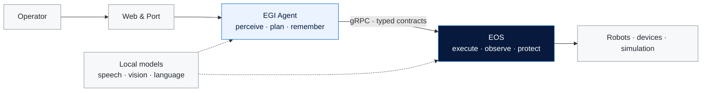

# Island Team

### Building embodied intelligence—from perception and memory to safety-gated action.

We develop **IslandOS Aether**, an open platform that connects model-driven cognition to simulated and physical worlds through explicit contracts and controlled execution.

  

---

## IslandOS Aether

Aether separates cognition from physical execution. The **EGI Agent** understands context, builds missions and plans, and requests typed primitives. **EOS** owns device integration and admits every command through a controlled action gate before it reaches hardware.

<table>
  <tr>
    <td width="50%" valign="top">
      

      <h3 align="center"><a href="https://github.com/Island-Team/Island-egia">Island-egia</a></h3>
      
<strong>EGI Agent · cognition and orchestration</strong>

      
Turns observations and operator intent into missions and plans, coordinates memory and monitoring, and safety-gates primitive requests before handing them to the embodied runtime.

      
<code>Python 3.12+</code> · <code>gRPC</code> · <code>WebSocket</code>

    </td>
    <td width="50%" valign="top">
      

      <h3 align="center"><a href="https://github.com/Island-Team/Island-eos">Island-eos</a></h3>
      
<strong>Embodied OS · execution and hard safety</strong>

      
Integrates devices, projects body state, exposes typed primitives, and provides the final controlled path to hardware—with demo and optional ROS 2 backends.

      
<code>C++17</code> · <code>gRPC</code> · <code>ProtoJSON</code>

    </td>
  </tr>
</table>

## The ecosystem

| Project | Role |
| :--- | :--- |
| **[Island-models](https://github.com/Island-Team/Island-models)** | Local serving and lifecycle tooling for speech, vision, language, translation, embedding, pose, and generative models. |
| **[Island-Base](https://github.com/Island-Team/Island-Base)** | Guarded C++ interfaces for the Jueying X30 vendor protocols—pose, navigation, manual motion, and launcher bridging. |
| **[Island-port](https://github.com/Island-Team/Island-port)** | Rust HTTP/WebSocket gateway for identity, messaging, documents, virtual wallets, and the Transnet boundary. |
| **[Island-web](https://github.com/Island-Team/Island-web)** | Bilingual web experience for the public site and Island operator surfaces. |

## Research & simulation

> ### 🌱 [Island OS](https://github.com/Island-Team/Island)
>
> A Rust-native research world where an **anima** inhabits **METALAND** with a body, senses, episodic memory, and an **Action–Critic–Experience** loop. It is our simulation track for exploring persistent, consequence-shaped AI characters—not a claim that today’s systems are conscious.

## What guides us

<table>
  <tr>
    <td width="33%" valign="top">
      <h3>◉ Embodied by design</h3>
      
Intelligence is grounded in perception, state, action, and what happens next—not only a text exchange.

    </td>
    <td width="33%" valign="top">
      <h3>◇ Contracts first</h3>
      
Typed, versioned boundaries keep cognition, models, runtimes, and hardware independently replaceable.

    </td>
    <td width="33%" valign="top">
      <h3>⛨ Safety at the boundary</h3>
      
Planning can stay creative; physical action still passes through explicit validation and controlled execution.

    </td>
  </tr>
</table>

---

**AI · Agent · Innovation**

[Website](https://os-island.com) · [Repositories](https://github.com/orgs/Island-Team/repositories) · [Contact](mailto:ashexlv278@gmail.com)

Let embodied agents come to life. Dudulu~

