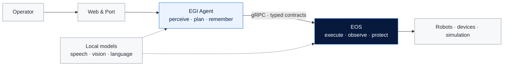

# Island Team

### Building embodied intelligence—from perception and memory to safety-gated action.

We develop **IslandOS Aether**, an open platform that connects model-driven cognition to simulated and physical worlds through explicit contracts and controlled execution.

  

  <a href="#islandos-aether">Platform</a> ·
  <a href="#the-ecosystem">Ecosystem</a> ·
  <a href="#our-teams--groups">Teams</a> ·
  <a href="#research--simulation">Research</a>

---

## IslandOS Aether

Aether separates cognition from physical execution. The **EGI Agent** understands context, builds missions and plans, and requests typed primitives. **EOS** owns device integration, read-only body and scene state, and command admission through an action gate before hardware execution.

**Public EOS source:** [Aether-EOS-R](https://github.com/Island-Team/Aether-EOS-R) launched with [Aether EOS 1.0.0](https://github.com/Island-Team/Aether-EOS-R/releases/tag/v1.0.0) on October 20, 2026. It includes a hardware-free demo profile, public ALSA/aplay, V4L2, and optional ROS 2 backends, Agent–EOS contracts, and a native skill SDK. Model services and deployment-specific vendor integrations are supplied separately.

  
  
  

<table>
  <tr>
    <td width="33%" align="center" valign="top">
      <h3>🧪 Try EOS</h3>
      
Start with the hardware-free demo profile and simulator.

      
<a href="https://github.com/Island-Team/Aether-EOS-R#quick-start">Quick start →</a>

    </td>
    <td width="33%" align="center" valign="top">
      <h3>🔌 Connect a robot</h3>
      
Use public device adapters and deployment-owned hardware profiles.

      
<a href="https://github.com/Island-Team/Aether-EOS-R#configure-a-robot">Configuration guide →</a>

    </td>
    <td width="33%" align="center" valign="top">
      <h3>🛡️ Build safely</h3>
      
Use typed contracts, command admission, and native skills.

      
<a href="https://github.com/Island-Team/Aether-EOS-R/tree/v1.0.0/docs/eos">EOS documentation →</a>

    </td>
  </tr>
</table>

<table>
  <tr>
    <td width="50%" valign="top">
      

      <h3 align="center"><a href="https://github.com/Island-Team/Island-egia">Island-egia</a></h3>
      
<strong>EGI Agent · cognition and orchestration</strong>

      
Turns observations and operator intent into missions and plans, coordinates memory and monitoring, and safety-gates primitive requests before handing them to the embodied runtime.

      
<code>Python 3.12+</code> · <code>gRPC</code> · <code>WebSocket</code>

    </td>
    <td width="50%" valign="top">
      

      <h3 align="center"><a href="https://github.com/Island-Team/Aether-EOS-R">Aether-EOS-R</a></h3>
      
<strong>Embodied OS · execution and hard safety · v1.0.0</strong>

      
Connects robot devices and perception, exposes read-only state, validates commands at the action gate, and runs native skills. Includes a hardware-free demo and public ROS 2 and host-device adapters.

      
<code>C++17</code> · <code>gRPC</code> · <code>HTTP/ProtoJSON + SSE</code> · <a href="https://github.com/Island-Team/Aether-EOS-R/releases/tag/v1.0.0">Release notes</a>

    </td>
  </tr>
</table>

## The ecosystem

| Project | Role |
| :--- | :--- |
| **[Island-models](https://github.com/Island-Team/Island-models)** | Local serving and lifecycle tooling for speech, vision, language, translation, embedding, pose, and generative models. |
| **[Island-Base](https://github.com/Island-Team/Island-Base)** | Guarded C++ interfaces for the Jueying X30 vendor protocols—pose, navigation, manual motion, and launcher bridging. |
| **[Island-port](https://github.com/Island-Team/Island-port)** | Rust HTTP/WebSocket gateway for identity, messaging, documents, virtual wallets, and the Transnet boundary. |
| **[Island-web](https://github.com/Island-Team/Island-web)** | Bilingual web experience for the public site and Island operator surfaces. |

## Our Teams / Groups

Island Team brings cognition, software, and hardware together through six focused groups. Each group owns a distinct layer of the platform while collaborating through shared, typed interfaces.

| 🧠 Intelligence | 🦾 Physical systems | 🌐 Experience |
| :--- | :--- | :--- |
| [Agent](#agent) · cognition and planning | [Arm](#arm) · manipulation | [FrontBackend](#frontbackend) · web and services |
| [MachineLearning](#machinelearning) · model development | [Base](#base) · mobility | [Hardware](#hardware) · electronics and integration |

### [Agent](https://github.com/orgs/Island-Team/teams/agent)

> **Team overview:** Embodied-agent cognition, memory, planning, orchestration, and safety-gated decision-making.

The Agent group develops the cognitive layer that turns admitted observations and operator intent into structured missions, plans, and typed primitive requests. Its work covers bounded context, model lanes, active perception, memory, tool use, monitoring, and cognitive safety gates. By communicating with EOS through stable contracts, the group keeps planning independent from hardware authority and supports sandbox, live-robot, and fleet deployments.

**Focus:** agent architecture · mission planning · memory · model/tool orchestration · cognitive safety

**Representative projects:** [Island-egia](https://github.com/Island-Team/Island-egia) · [Island](https://github.com/Island-Team/Island)

### [Arm](https://github.com/orgs/Island-Team/teams/arm)

> **Team overview:** Robotic manipulation, motion planning, teleoperation, grasping, and arm integration.

The Arm group builds the manipulation stack that lets Island systems interact precisely with the physical world. Its current work includes ROS 2 control for RealMan RM65 arms, RGB-D perception, gripper integration, motion and grasp planning, teleoperation, and dual-arm workcells. The group also develops demonstration-data and VLA-policy deployment paths while keeping hardware drivers and safety-critical execution clearly separated from learned policies.

**Focus:** manipulation · motion planning · grasping · teleoperation · policy deployment

**Representative projects:** [Island-Arm](https://github.com/Island-Team/Island-Arm) · [Island-Teaching-Arm](https://github.com/Island-Team/Island-Teaching-Arm) · [rm65-openpi](https://github.com/Island-Team/rm65-openpi) · [Robocup_GECA_ARM](https://github.com/Island-Team/Robocup_GECA_ARM)

### [Base](https://github.com/orgs/Island-Team/teams/base)

> **Team overview:** Mobile-robot locomotion, navigation, simulation, deployment, and guarded base control.

The Base group develops the guarded interfaces and deployment tools through which robots move in their environments. Current platforms include Jueying X30 vendor transports for pose, bounded manual motion, and route execution, plus Unitree A1 development across ROS 1/Gazebo and ROS 2. The group keeps platform-specific protocols behind stable boundaries so higher-level runtimes do not need to depend on wire formats or vendor control details.

**Focus:** locomotion · navigation · base drivers · simulation · robot-side deployment

**Representative projects:** [Island-Base](https://github.com/Island-Team/Island-Base) · [Base-UnitreeA1-2607](https://github.com/Island-Team/Base-UnitreeA1-2607) · [isaacsim](https://github.com/Island-Team/isaacsim)

### [FrontBackend](https://github.com/orgs/Island-Team/teams/frontbackend)

> **Team overview:** Web experiences, service APIs, communication gateways, and operator-facing tools.

The FrontBackend group creates the interfaces through which people and services interact with Island. It develops the bilingual public website and Aether browser console, including views of health, missions, models, perceptions, primitives, and robot backends. It also maintains the HTTP/WebSocket gateway for authentication, profiles, messaging, discussion documents, virtual wallets, Transnet integration, and optional application hosting.

**Focus:** frontend engineering · service APIs · WebSocket communication · identity · operator experience

**Representative projects:** [Island-web](https://github.com/Island-Team/Island-web) · [Island-port](https://github.com/Island-Team/Island-port)

### [Hardware](https://github.com/orgs/Island-Team/teams/hardware)

> **Team overview:** Physical-system design and the integration of electronics, sensors, actuators, and mechanics.

The Hardware group turns system designs into reliable physical platforms. It selects and integrates sensors, actuators, compute, power, communications, and mechanical components, then works with the Arm and Base groups on calibration and safe software exposure. The group supports assembly, bring-up, teleoperation hardware, diagnostics, and iterative prototype validation on the team's own robot platforms.

**Focus:** mechatronics · electronics · sensing · actuation · system integration · hardware validation

**Representative project:** [Island-Teaching-Arm](https://github.com/Island-Team/Island-Teaching-Arm)

### [MachineLearning](https://github.com/orgs/Island-Team/teams/machinelearning)

> **Team overview:** Training, evaluation, deployment, and operation of perception and reasoning models.

The MachineLearning group develops and operates the models that help Island systems perceive, understand, and respond to the world. Its work spans dataset preparation, training and evaluation pipelines, GPU and edge deployment, and config-driven local serving. Current model services cover speech, voice activity, vision-language and language reasoning, translation, embeddings, pose and posture, image-to-video, and image-to-3D workflows.

**Focus:** model training · evaluation · inference · computer vision · language and speech · MLOps

**Representative projects:** [Island-models](https://github.com/Island-Team/Island-models) · [PoseDetection](https://github.com/Island-Team/PoseDetection) · [YOLO-v11-training_pipeline](https://github.com/Island-Team/YOLO-v11-training_pipeline)

## Research & simulation

> ### 🌱 [Island OS](https://github.com/Island-Team/Island)
>
> A Rust-native research world where an **anima** inhabits **METALAND** with a body, senses, episodic memory, and an **Action–Critic–Experience** loop. It is our simulation track for exploring persistent, consequence-shaped AI characters—not a claim that today’s systems are conscious.

## What guides us

<table>
  <tr>
    <td width="33%" valign="top">
      <h3>◉ Embodied by design</h3>
      
Intelligence is grounded in perception, state, action, and what happens next—not only a text exchange.

    </td>
    <td width="33%" valign="top">
      <h3>◇ Contracts first</h3>
      
Typed, versioned boundaries keep cognition, models, runtimes, and hardware independently replaceable.

    </td>
    <td width="33%" valign="top">
      <h3>⛨ Safety at the boundary</h3>
      
Planning can stay creative; physical action still passes through explicit validation and controlled execution.

    </td>
  </tr>
</table>

---

**AI · Agent · Innovation**

[Website](https://os-island.com) · [Repositories](https://github.com/orgs/Island-Team/repositories) · [Contact](mailto:ashexlv278@gmail.com)

Let embodied agents come to life. Dudulu~

