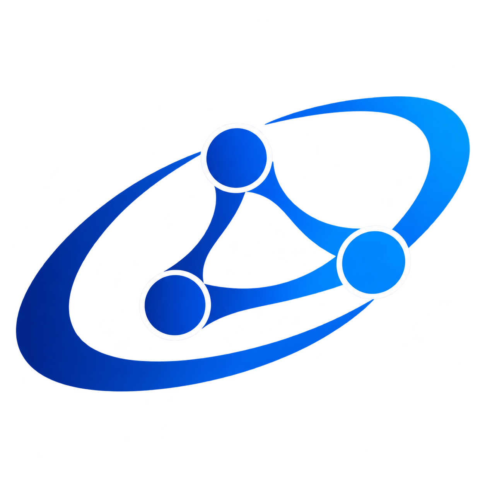
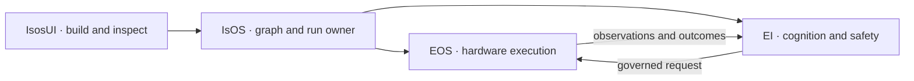

# Island Team

### Building open foundations for embodied intelligence

IslandOS connects robot hardware, cognition, and an inspectable graph so agents can be built, run, and studied across simulation and physical systems.

[Website](https://os-island.com) · [Public IslandOS source](https://github.com/Island-Team/isos-aether) · [Repositories](https://github.com/orgs/Island-Team/repositories)

 

## IslandOS · IsOS

**IslandOS (IsOS)** owns the deployment graph: verified packages, saved revisions, Apply, process supervision, and the browser workbench. A graph makes the relationships between observations, decisions, actions, and outcomes visible. The current architecture separates the owners of cognition and physical execution so that a model cannot create an unchecked actuator route.

| Core | Current responsibility | Target direction |
| --- | --- | --- |
| **IsOS** | Owns the graph, packages, run state, and IsosUI workbench. | A clear environment for building, debugging, and comparing embodied experiments. |
| **EOS** | Owns device adapters, health, command admission, and execution. | An Embodied Hardware Abstraction Layer (E-HAL) with qualified, body-aware primitives. |
| **EI** | Owns cognition stages and a local safety gate. | A Python runtime for tensor-based planners, model integration, training, and reusable skills. |

  &nbsp;&nbsp;&nbsp;&nbsp;
  

The long-term goal is an **open node and skill ecosystem**. Contributors should be able to share adapters, models, planners, dataset tools, evaluators, and learned body primitives with clear contracts, provenance, and measured behavior. Body adaptation and self-learning primitive discovery are target designs, not current product capabilities.

Explore the [public source](https://github.com/Island-Team/isos-aether) for the implementation and current documentation. Interface and runtime versions are independent; the repository's own guides are the source of truth for supported behavior.

The earlier [EOS v1.0.0 release](https://github.com/Island-Team/isos-aether/releases/tag/v1.0.0) remains available as a historical milestone. Use the current repository guides for the active architecture and setup path.

## How the parts work together

EOS admits every actuator command. EI may propose an action and reject it at its safety gate; IsOS owns the applied revision and process lifecycle. The graph reveals the connection, while each process boundary keeps its own authority and contract.

## Public projects and research tools

| Repository | Focus |
| --- | --- |
| [isos-aether](https://github.com/Island-Team/isos-aether) | Public IslandOS source, owner contracts, and development guides. |
| [isos-mujoco-sim](https://github.com/Island-Team/isos-mujoco-sim) | MuJoCo simulation package for embodied experiments. |
| [YOLO-v11-training_pipeline](https://github.com/Island-Team/YOLO-v11-training_pipeline) | Computer-vision training workflow from the MachineLearning group. |

Other team projects may have separate access or release status; the [organization repository list](https://github.com/orgs/Island-Team/repositories) shows what is available to each visitor.

## The people behind the platform

Island Team brings together six groups that work across the embodied stack.

| Group | Focus |
| --- | --- |
| **Agent** | Cognition, memory, missions, planning, and safety-gated decisions. |
| **MachineLearning** | Datasets, model training, evaluation, and inference. |
| **Arm** | Manipulation, grasping, teleoperation, and arm integration. |
| **Base** | Mobility, navigation, simulation, and robot-side deployment. |
| **Hardware** | Electronics, sensors, actuators, mechanics, and validation. |
| **FrontBackend** | Web experiences, service APIs, and operator tools. |

## What guides us

- **Embodied by design:** Connect perception and reasoning to physical feedback and outcomes.
- **Contracts first:** Keep graph, model, runtime, and hardware boundaries explicit and versioned.
- **Measured progress:** Compare methods, record failures, and qualify capabilities before deployment.
- **Safety at the boundary:** Admit physical actions through EOS, with predictable Stop behavior.

We welcome work that makes embodied systems more understandable, reproducible, and useful. Start with the [public IslandOS repository](https://github.com/Island-Team/isos-aether) and its contribution and interface guidance.

[Website](https://os-island.com) · [Repositories](https://github.com/orgs/Island-Team/repositories) · [Contact](mailto:ashexlv278@gmail.com)

